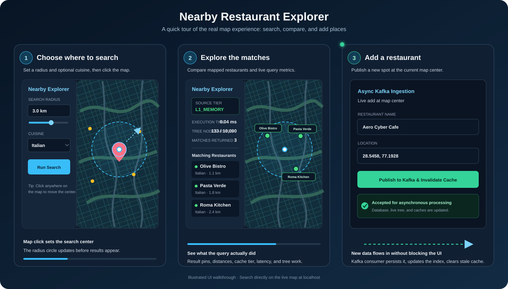
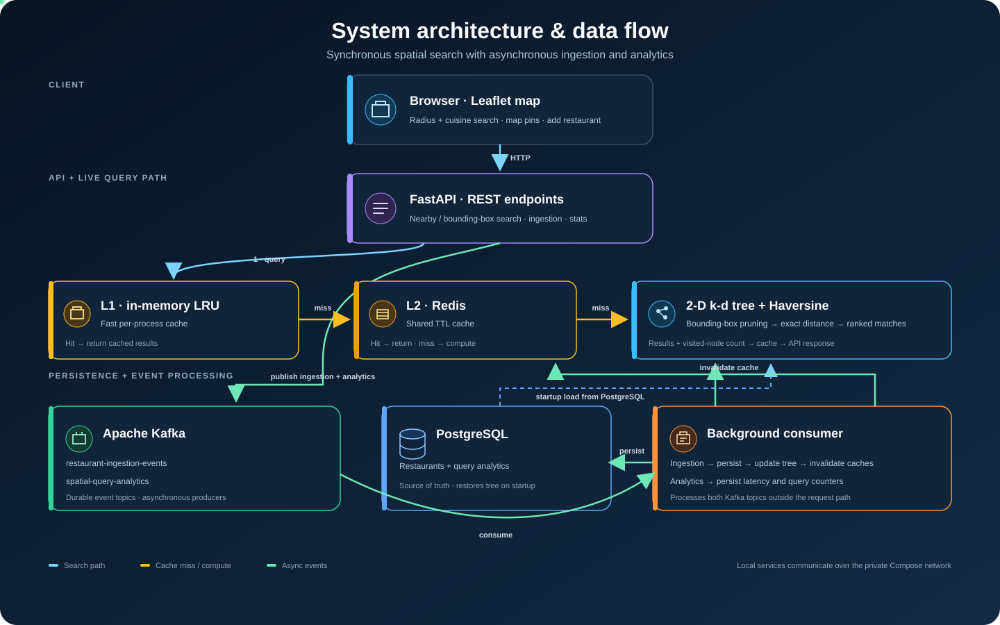

# Nearby Restaurant Explorer

A location-based restaurant discovery system engineered around a **custom 2-D Spatial Tree (k-d tree)** for sub-millisecond range queries, backed by a **Two-Tier Caching Architecture (L1 In-Memory LRU + L2 Redis)**, **PostgreSQL**, and **Apache Kafka** for asynchronous event ingestion and query telemetry.

---

## Core Architecture & Features

1. **Custom 2-D Spatial Tree (`app/kdtree.py`)**
   - Built from scratch using recursive median partitioning alternating across Latitude (`axis=0`) and Longitude (`axis=1`) hyperplanes.
   - **Circular Range Search**: Computes a spherical bounding box around `(lat, lon, radius_km)` to prune non-intersecting subtrees in $O(\sqrt{N} + K)$ time before applying exact **Haversine** great-circle distance filtering.
   - **Orthogonal Bounding-Box Search**: Supports rectangular viewport queries (`min_lat`, `max_lat`, `min_lon`, `max_lon`) for map panning.
   - Thread-safe concurrent reads and live dynamic insertions via `threading.RLock`.

2. **Two-Tier Spatial Caching (`app/cache.py`)**
   - **Quantized Grid Snapping**: Coordinates are snapped to a configurable decimal grid (`GRID_PRECISION_DECIMALS=3`, ~110m resolution) so nearby users share warm cache entries.
   - **L1 In-Memory LRU Cache**: Thread-safe `OrderedDict` delivering sub-10 microsecond hits for hot locations.
   - **L2 Distributed Redis Cache**: Shared across API worker instances with configurable TTL and automatic fallback if Redis is offline.

3. **Asynchronous Event Processing with Apache Kafka (`app/kafka_bus.py`)**
   - **`restaurant-ingestion-events`**: `POST /api/v1/restaurants` publishes new restaurants to Kafka (`202 Accepted`), where a background consumer persists the row to PostgreSQL, dynamically inserts the node into the live 2-D Tree, and invalidates stale L1/L2 spatial cache keys.
   - **`spatial-query-analytics`**: Every spatial search asynchronously streams execution latency, cache-tier hit status, and 2-D Tree pruning counts to Kafka for persistence in PostgreSQL without blocking API responses.

4. **Interactive Leaflet.js Spatial Visualizer (`static/index.html`)**
   - Click anywhere on the map to run live radius searches, toggle between `L1 -> L2 -> 2-D Tree`, `Force 2-D Tree`, and `Brute-Force O(N)` modes, inspect visited node counts, and publish live restaurant additions to Kafka.

---

## User-side Demo

<div align="center">
  
</div>

Choose a radius and cuisine, click the map to search, inspect matching pins and query telemetry, then publish a new restaurant from the current map center.

## Architecture Demo

<div align="center">
  
</div>

The diagram distinguishes the live search path (API → L1 → Redis → spatial tree on cache misses) from background ingestion and analytics events processed through Kafka.

---

## Quick Start (Docker Compose)

Requirements: Git and Docker Desktop (Windows/macOS) or Docker Engine with the Compose plugin (Linux). Start Docker, clone the repository, and run these commands from the repository root:

```bash
docker compose up --build -d
docker compose ps
```

On Windows, if PowerShell says `docker` is not recognized and Docker Desktop was installed for your user, add its CLI directory to this terminal's `PATH` before running Compose:

```powershell
$env:Path += ";$env:LOCALAPPDATA\Programs\DockerDesktop\resources\bin"
```

Compose starts the API, PostgreSQL, Redis, Kafka, and ZooKeeper. On first startup, the app creates its database tables and seeds 10,000 sample restaurants. The database is stored in a named Docker volume and survives container restarts.

- **Interactive Map UI**: `http://localhost:8000/`
- **Swagger OpenAPI Docs**: `http://localhost:8000/docs`
- **System & Cache Telemetry**: `http://localhost:8000/api/v1/stats`

If port `8000` is already in use or reserved on your machine, select a different host port:

```powershell
$env:API_PORT = 8080
docker compose up --build -d
```

Open `http://localhost:8080/` when the API container reports healthy. The override applies only to the current PowerShell session.

### Tests and useful commands

Run the test suite in the same container environment as the app:

```bash
docker compose exec api python -m pytest -q
```

Run the benchmark with the Compose Redis service:

```bash
docker compose exec api python scripts/benchmark.py
```

View API logs or stop the services:

```bash
docker compose logs -f api
docker compose down
```

`docker compose down` preserves the database volume. To also delete the stored database and start fresh, run `docker compose down --volumes`.

The database, Redis, Kafka, and ZooKeeper ports are private to the Compose network; only the web API is published to the host. Compose uses local development credentials for this demo—do not expose this setup directly to the public internet.

### Local demo

```bash
python demo.py
```

This runs a small sample query against the custom 2-D tree and prints nearby restaurant matches.

---

## Local Python development

The project is pinned and tested with Python 3.11. Install dependencies in that interpreter, then run tests:

```bash
python -m venv .venv
# Activate the virtual environment before continuing.
pip install -r requirements.txt
python -m pytest -q
```

The API itself requires PostgreSQL, Redis, and Kafka; use Docker Compose to start those services. The standalone `demo.py` only exercises the in-memory spatial tree and does not require the service stack.

GitHub Actions runs the tests and builds the Docker image on pushes and pull requests.
